# CẨM NANG QUẢN TRỊ HỆ THỐNG WEBSITE HUONGSONCO.COM.VN
> **Đơn vị chủ quản:** CÔNG TY TNHH THƯƠNG MẠI & DỊCH VỤ HƯƠNG SƠN (Thành lập năm 1993)
> **Lĩnh vực:** Máy photocopy Toshiba / Konica Minolta, Máy in nhân bản kỹ thuật số Duplo Nhật Bản, Máy scan Ricoh, Vật tư & Mực in chính hãng Fansipan.
> **Địa chỉ:** Tầng 4, Tòa nhà 29T1 Hoàng Đạo Thúy, Cầu Giấy, Hà Nội | Showroom & Kho: Số 40 ngõ 106 Hoàng Quốc Việt, Cầu Giấy, Hà Nội
> **Hotline hỗ trợ:** 0903.229.828 - 0968.229.828 | **Website:** https://huongsonco.com.vn
> **Phiên bản:** Release v1.0.0 (2026) | Ngôn ngữ: 100% Tiếng Việt chuẩn hóa
> **File PDF bàn giao in ấn:** `docs/Huong_Dan_Su_Dung_Admin_Huong_Son.pdf`

---

## MỤC LỤC CHI TIẾT (18 CHƯƠNG TOÀN DIỆN)

1. [Giới Thiệu & Đăng Nhập Bảo Mật](#chuong-1-intro) - *TỔNG QUAN HỆ THỐNG* (`LOGIN & AUTH`)
2. [Bảng Điều Khiển & Thống Kê Kinh Doanh (Dashboard)](#chuong-2-dashboard) - *TỔNG QUAN HỆ THỐNG* (`DASHBOARD`)
3. [Phân Quyền & Quản Lý Thành Viên (Users & Roles)](#chuong-3-users-roles) - *TÀI KHOẢN & PHÂN QUYỀN* (`USERS & ROLES`)
4. [Quản Lý Thiết Bị Photocopy, Máy In & Vật Tư (Catalog Products)](#chuong-4-products-catalog) - *THIẾT BỊ & VẬT TƯ HƯƠNG SƠN* (`CATALOG`)
5. [Cấu Hình Tùy Chọn & Biến Thể Thiết Bị (Options & Variants)](#chuong-5-product-options) - *THIẾT BỊ & VẬT TƯ HƯƠNG SƠN* (`VARIANTS`)
6. [Quản Lý & Xử Lý Đơn Hàng (Orders Processing & Shipping)](#chuong-6-orders-shipping) - *BÁN HÀNG & THƯƠNG MẠI* (`ORDERS`)
7. [Tiếp Nhận & Xử Lý Yêu Cầu Báo Giá / Thuê Máy (RFQ & Leads)](#chuong-7-rfq-leads) - *BÁN HÀNG & THƯƠNG MẠI* (`LEADS & RFQ`)
8. [Cẩm Nang Kỹ Thuật, Hướng Dẫn Sửa Lỗi & Chuẩn SEO (Posts & SEO)](#chuong-8-posts-seo) - *NỘI DUNG & TRUYỀN THÔNG* (`POSTS & SEO`)
9. [Mã Giảm Giá & Chương Trình Khuyến Mãi (Vouchers & Promotions)](#chuong-9-vouchers-promotions) - *BÁN HÀNG & THƯƠNG MẠI* (`PROMOTIONS`)
10. [Kiểm Duyệt Đánh Giá Khách Hàng (Customer Reviews Moderation)](#chuong-10-reviews) - *NỘI DUNG & TRUYỀN THÔNG* (`REVIEWS`)
11. [Quản Lý Banner & Chiến Dịch Trưng Bày (Banners & Hero Sliders)](#chuong-11-banners) - *GIAO DIỆN & TRẢI NGHIỆM* (`BANNERS`)
12. [Quản Lý Menu Điều Hướng Website (Navigation Menus)](#chuong-12-menus) - *GIAO DIỆN & TRẢI NGHIỆM* (`MENUS`)
13. [Thư Viện File, Driver & Tài Liệu PDF (Media Library)](#chuong-13-media) - *NỘI DUNG & TRUYỀN THÔNG* (`MEDIA`)
14. [Quản Trị Khối Tĩnh & Trang Nội Dung (Site Blocks & CMS Pages)](#chuong-14-pages-blocks) - *GIAO DIỆN & TRẢI NGHIỆM* (`SITE BLOCKS`)
15. [Cài Đặt Hệ Thống, Cổng Thanh Toán & Vận Chuyển (System Settings)](#chuong-15-settings-shipping) - *CẤU HÌNH & HỆ THỐNG* (`SETTINGS`)
16. [Quản Lý Đa Ngôn Ngữ Song Ngữ (Localization & Languages)](#chuong-16-languages) - *CẤU HÌNH & HỆ THỐNG* (`LANGUAGES`)
17. [Nhật Ký Kiểm Toán & Truy Vết Bảo Mật (Activity Audit Logs)](#chuong-17-activity-logs) - *CẤU HÌNH & HỆ THỐNG* (`AUDIT LOGS`)
18. [Công Cụ Ước Tính Chi Phí Thuê Máy Photocopy & TCO (Storefront Tools)](#chuong-18-rental-calculator) - *CÔNG CỤ TÍNH TOÁN ĐẶC THÙ* (`CALCULATOR & TCO`)

---

## CHƯƠNG 1: GIỚI THIỆU & ĐĂNG NHẬP BẢO MẬT

**Phân loại:** `TỔNG QUAN HỆ THỐNG` | **Đặc tả nhãn:** `LOGIN & AUTH`

**Mô tả tổng quan:** Hướng dẫn đăng nhập hệ thống quản trị Hương Sơn an toàn, cơ chế bảo vệ phiên làm việc chống tấn công dò quét mật khẩu (brute-force) và quy trình lấy lại mật khẩu qua email xác thực.

### 1. Quy trình thao tác chuẩn từng bước
- Mở trình duyệt web (Google Chrome, Microsoft Edge hoặc Safari) và truy cập đường dẫn quản trị: `https://huongsonco.com.vn/vi/admin/login` (hoặc `https://huongsonco.com.vn/admin`).
- Nhập chính xác Email quản trị viên được cấp (VD: `admin@huongsonco.com.vn`) và Mật khẩu bảo mật.
- Tích chọn 'Ghi nhớ đăng nhập' nếu sử dụng máy tính cá nhân trong văn phòng làm việc để duy trì phiên làm việc trong 30 ngày.
- Nhấn nút 'Đăng nhập' màu xanh lá để truy cập vào Bảng điều khiển quản trị Hương Sơn.
- Trường hợp quên mật khẩu: Bấm liên kết 'Quên mật khẩu?', điền email quản trị và kiểm tra hòm thư để nhận liên kết đặt lại mật khẩu an toàn.

### 2. Giao diện thực tế & Đường dẫn màn hình (Screenshots)
> 🌐 **Đường dẫn màn hình:** `https://huongsonco.com.vn/vi/admin/login`
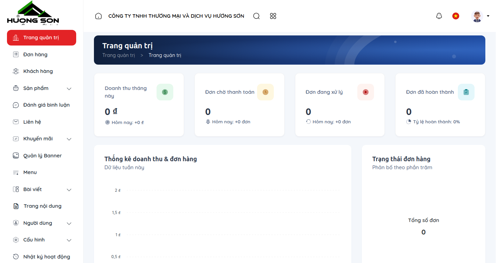

### 3. Bảng tra cứu hành động & Ký hiệu thao tác
| Ký hiệu | Khu vực / Tên trường | Hướng dẫn thao tác & Lưu ý nghiệp vụ |
| :---: | :--- | :--- |
| **①** | **Ô nhập Email quản trị** | Nhập email tài khoản quản trị viên do công ty cấp. Tài khoản phải ở trạng thái hoạt động (is_active = 1). |
| **②** | **Ô nhập Mật khẩu** | Mật khẩu quản trị được mã hóa chuẩn Bcrypt. Hỗ trợ nút con mắt để kiểm tra ký tự trước khi xác nhận. |
| **③** | **Ghi nhớ phiên đăng nhập** | Lưu token đăng nhập vào cookie bảo mật (HttpOnly, Secure, SameSite=Lax) trong vòng 30 ngày. |
| **④** | **Cơ chế Rate Limiting** | Hệ thống bảo vệ chống brute-force tự động khóa IP 60 giây nếu nhập sai thông tin liên tiếp 5 lần. |

### 4. Lưu ý nghiệp vụ quan trọng
- 💡 **Lưu ý nghiệp vụ:** Mật khẩu quản trị viên bắt buộc tối thiểu 8 ký tự, khuyến nghị có chữ hoa, chữ thường, số và ký tự đặc biệt.
- 💡 **Lưu ý nghiệp vụ:** Tuyệt đối không sử dụng chung tài khoản giữa bộ phận kỹ thuật bảo trì và kế toán để đảm bảo tính minh bạch kiểm toán.

---

## CHƯƠNG 2: BẢNG ĐIỀU KHIỂN & THỐNG KÊ KINH DOANH (DASHBOARD)

**Phân loại:** `TỔNG QUAN HỆ THỐNG` | **Đặc tả nhãn:** `DASHBOARD`

**Mô tả tổng quan:** Trung tâm chỉ huy trực quan hóa toàn bộ hoạt động kinh doanh của Hương Sơn: Doanh thu thiết bị & vật tư, số lượng đơn hàng mới, danh sách yêu cầu thuê máy/báo giá cần phản hồi tức thời.

### 1. Quy trình thao tác chuẩn từng bước
- Sau khi đăng nhập thành công, hệ thống tự động điều hướng về màn hình Dashboard tại `https://huongsonco.com.vn/vi/admin`.
- Quan sát nhanh 4 thẻ thống kê (KPI Cards) phía trên: Doanh thu tổng hợp, Đơn hàng mới phát sinh, Số lượng máy & vật tư đang kinh doanh, Tổng số khách hàng/doanh nghiệp đã lưu.
- Kiểm tra biểu đồ biến động doanh thu theo tuần/tháng để nắm bắt xu hướng đặt hàng thiết bị và vật tư tiêu hao.
- Theo dõi danh sách 'Đơn hàng gần đây' và 'Yêu cầu tư vấn/Báo giá mới' nằm ở nửa dưới màn hình để xử lý ngay trong ngày.

### 2. Giao diện thực tế & Đường dẫn màn hình (Screenshots)
> 🌐 **Đường dẫn màn hình:** `https://huongsonco.com.vn/vi/admin`

### 3. Bảng tra cứu hành động & Ký hiệu thao tác
| Ký hiệu | Khu vực / Tên trường | Hướng dẫn thao tác & Lưu ý nghiệp vụ |
| :---: | :--- | :--- |
| **①** | **Thanh Menu dọc (Sidebar)** | Điều hướng nhanh đến 15+ module nghiệp vụ: Máy photocopy, Máy in Duplo, Đơn hàng, RFQ, Vouchers, Cài đặt... |
| **②** | **Thanh công cụ đỉnh (Header)** | Tìm kiếm nhanh toàn hệ thống, chuyển đổi giao diện Tiếng Việt/English, chuông thông báo đơn hàng/lead mới phát sinh. |
| **③** | **Thẻ chỉ số tổng quan (KPI)** | Hiển thị doanh thu, đơn hàng, danh mục sản phẩm, khách hàng được tổng hợp thời gian thực từ cơ sở dữ liệu. |
| **④** | **Bảng dữ liệu xử lý khẩn** | Danh sách 10 đơn hàng và liên hệ mới nhất cần xác nhận, kèm nút xem chi tiết nhanh. |

### 4. Lưu ý nghiệp vụ quan trọng
- 💡 **Lưu ý nghiệp vụ:** Khi có khách gửi yêu cầu thuê máy hoặc đặt mua mực in Fansipan trên storefront, chuông thông báo trên Header sẽ hiển thị chấm đỏ kèm số lượng thông báo mới.
- 💡 **Lưu ý nghiệp vụ:** Dữ liệu doanh thu chỉ tính các đơn hàng ở trạng thái 'Đã thanh toán' hoặc 'Hoàn tất giao hàng'.

---

## CHƯƠNG 3: PHÂN QUYỀN & QUẢN LÝ THÀNH VIÊN (USERS & ROLES)

**Phân loại:** `TÀI KHOẢN & PHÂN QUYỀN` | **Đặc tả nhãn:** `USERS & ROLES`

**Mô tả tổng quan:** Phân chia quyền hạn chặt chẽ theo chức năng phòng ban tại Hương Sơn (Ban Giám Đốc, Kế toán, Kỹ thuật viên bảo trì máy photo, Nhân viên kinh doanh, Biên tập viên nội dung) và cơ chế Đăng nhập phân thân (Impersonate).

### 1. Quy trình thao tác chuẩn từng bước
- Truy cập menu 'Quản trị viên' > 'Người dùng' (`/vi/admin/users`) để xem danh sách nhân sự vận hành.
- Thêm người dùng mới: Nhấn nút 'Thêm người dùng', điền Họ tên, Email, Mật khẩu khởi tạo và chọn Vai trò phù hợp.
- Quản lý vai trò & quyền hạn: Truy cập menu 'Vai trò' (`/vi/admin/roles`). Có thể tạo vai trò mới hoặc chỉnh sửa danh sách quyền hạn hạt nhân (như chỉ được duyệt đơn hàng, hoặc chỉ được viết bài kỹ thuật).
- Đăng nhập phân thân (Superadmin): Nhấn nút 'Đăng nhập với tư cách...' bên cạnh tài khoản nhân viên để kiểm tra góc nhìn giao diện của nhân sự đó, nhấn 'Rời phân thân' ở góc trên để quay lại tài khoản chính.

### 2. Giao diện thực tế & Đường dẫn màn hình (Screenshots)
> 🌐 **Đường dẫn màn hình:** `https://huongsonco.com.vn/vi/admin/users`
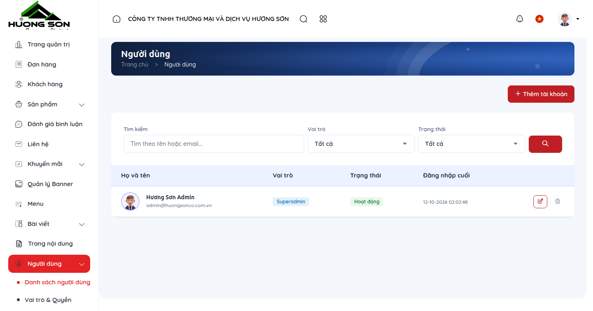

### 3. Bảng tra cứu hành động & Ký hiệu thao tác
| Ký hiệu | Khu vực / Tên trường | Hướng dẫn thao tác & Lưu ý nghiệp vụ |
| :---: | :--- | :--- |
| **①** | **Bảng danh sách thành viên** | Hiển thị tên nhân sự, email, vai trò hiện tại, trạng thái hoạt động và ngày tham gia. |
| **②** | **Nút bật/tắt trạng thái** | Khóa nhanh tài khoản nhân sự nghỉ việc chỉ với 1 click mà không cần xóa dữ liệu lịch sử. |
| **③** | **Nút Phân thân (Impersonate)** | Chức năng độc quyền của Superadmin giúp hỗ trợ nhân viên từ xa mà không cần hỏi mật khẩu. |
| **④** | **Ma trận quyền hạn (Roles)** | Cấu hình chi tiết các quyền: xem, tạo, sửa, xóa, xuất excel, duyệt giá thiết bị. |

### 4. Lưu ý nghiệp vụ quan trọng
- 💡 **Lưu ý nghiệp vụ:** Không bao giờ cấp vai trò 'Superadmin' cho nhân viên thời vụ hoặc cộng tác viên viết bài SEO.
- 💡 **Lưu ý nghiệp vụ:** Mọi thao tác chỉnh sửa vai trò hay đăng nhập phân thân đều được ghi nhận vào Nhật ký kiểm toán (Activity Logs).

---

## CHƯƠNG 4: QUẢN LÝ THIẾT BỊ PHOTOCOPY, MÁY IN & VẬT TƯ (CATALOG PRODUCTS)

**Phân loại:** `THIẾT BỊ & VẬT TƯ HƯƠNG SƠN` | **Đặc tả nhãn:** `CATALOG`

**Mô tả tổng quan:** Quản lý toàn bộ danh mục sản phẩm cốt lõi của Hương Sơn: Máy photocopy Toshiba, Konica Minolta; Máy in nhân bản Duplo Nhật Bản; Máy scan Ricoh; Mực in & Phụ tùng chính hãng Fansipan.

### 1. Quy trình thao tác chuẩn từng bước
- Truy cập menu 'Sản phẩm' > 'Tất cả sản phẩm' (`/vi/admin/products`) để quản lý kho thiết bị.
- Tạo sản phẩm mới: Nhấn nút 'Thêm sản phẩm', nhập Tên máy (VD: `Máy Photocopy Toshiba e-STUDIO 3528A` hoặc `Máy In Nhân Bản Duplo DP-F550`).
- Chọn Danh mục (Máy Photocopy / Máy In Siêu Tốc / Mực In & Vật Tư) và Thương hiệu (Toshiba / Duplo / Konica / Fansipan).
- Thiết lập Giá bán niêm yết, Giá khuyến mãi và Giá thuê tham khảo (đối với dòng máy cho thuê).
- Nhập Thông số kỹ thuật chi tiết: Tốc độ in (ppm), Độ phân giải (dpi), Khổ giấy tối đa (A3/A4), Dung lượng khay nạp, Chu kỳ công suất hàng tháng.
- Tải lên Ảnh đại diện, Bộ ảnh thư viện thực tế (Gallery) và File tài liệu Brochure/Catalogue PDF đính kèm.
- Lưu và kiểm tra hiển thị trên website storefront.

### 2. Giao diện thực tế & Đường dẫn màn hình (Screenshots)
> 🌐 **Đường dẫn màn hình:** `https://huongsonco.com.vn/vi/admin/products`
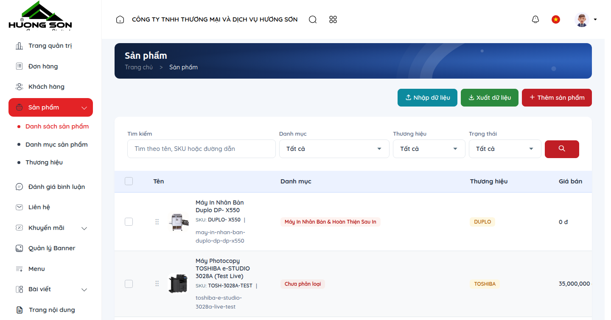

### 3. Bảng tra cứu hành động & Ký hiệu thao tác
| Ký hiệu | Khu vực / Tên trường | Hướng dẫn thao tác & Lưu ý nghiệp vụ |
| :---: | :--- | :--- |
| **①** | **Bộ lọc danh mục & thương hiệu** | Lọc nhanh theo dòng máy Toshiba, Duplo, Konica hoặc vật tư Fansipan, lọc theo trạng thái còn hàng/hết hàng. |
| **②** | **Nhập / Xuất dữ liệu Excel** | Hỗ trợ xuất báo cáo bảng giá toàn bộ máy và nhập sản phẩm hàng loạt qua file mẫu Excel. |
| **③** | **Chỉnh sửa nhanh thông số & giá** | Cập nhật nhanh giá bán, giá thuê và số lượng tồn kho trực tiếp trên bảng danh sách. |
| **④** | **Quản lý Danh mục & Thương hiệu** | Menu con cho phép sắp xếp thứ tự ưu tiên hiển thị các dòng máy chủ lực lên trang chủ. |

### 4. Lưu ý nghiệp vụ quan trọng
- 💡 **Lưu ý nghiệp vụ:** Hình ảnh máy chụp thực tế tại kho Hương Sơn cần có độ phân giải tối thiểu 800x800px, phông nền sáng rõ ràng để khách hàng tin tưởng.
- 💡 **Lưu ý nghiệp vụ:** Tên sản phẩm nên chứa model chính xác (VD: Duplo DP-F850, Toshiba 4528A) để tối ưu tìm kiếm Google (SEO).

---

## CHƯƠNG 5: CẤU HÌNH TÙY CHỌN & BIẾN THỂ THIẾT BỊ (OPTIONS & VARIANTS)

**Phân loại:** `THIẾT BỊ & VẬT TƯ HƯƠNG SƠN` | **Đặc tả nhãn:** `VARIANTS`

**Mô tả tổng quan:** Cấu hình các gói phụ kiện mở rộng cho máy photocopy và máy in siêu tốc: Bộ nạp đảo bản gốc RADF/DSDF, Khay nạp giấy mở rộng (Large Capacity Feeder), Bộ dập ghim hoàn thiện (Finisher), Card Wifi...

### 1. Quy trình thao tác chuẩn từng bước
- Tại danh sách sản phẩm, bấm vào nút 'Tùy chọn' (Options) của một dòng máy photocopy (VD: Toshiba e-STUDIO 2528A).
- Thêm nhóm tùy chọn: Nhấn 'Thêm tùy chọn', đặt tên (VD: 'Cấu hình khay nạp', 'Bộ nạp bản gốc', 'Thời hạn bảo hành').
- Thêm các giá trị lựa chọn: VD 'Khay tiêu chuẩn 2 ngăn 550 tờ', 'Khay mở rộng 4 ngăn 2.000 tờ (+5.000.000đ)'.
- Sinh biến thể tự động: Bấm 'Tạo ma trận biến thể' để hệ thống tự động kết hợp các tùy chọn thành các SKU riêng biệt.
- Thiết lập giá chênh lệch và mã tồn kho cho từng cấu hình máy.

### 2. Giao diện thực tế & Đường dẫn màn hình (Screenshots)
> 🌐 **Đường dẫn màn hình:** `https://huongsonco.com.vn/vi/admin/products/1/options`
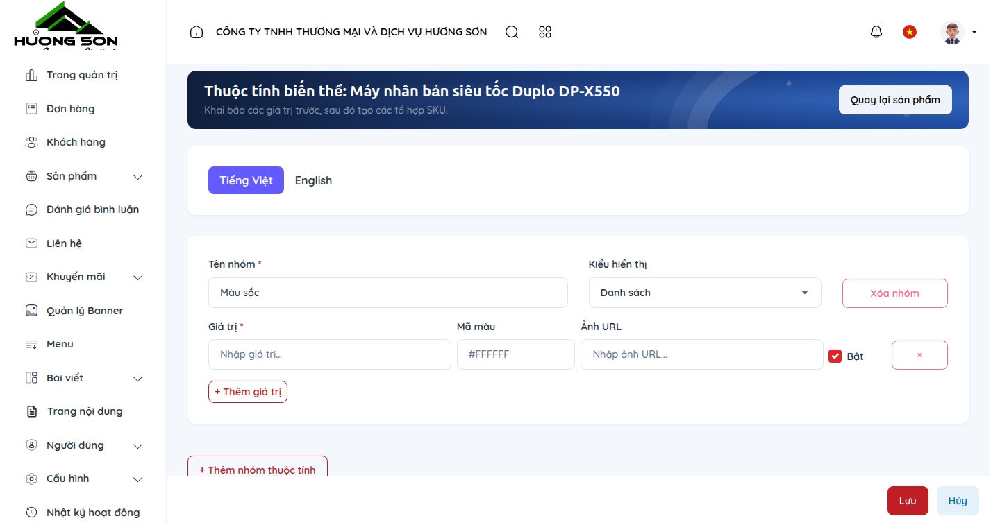

### 3. Bảng tra cứu hành động & Ký hiệu thao tác
| Ký hiệu | Khu vực / Tên trường | Hướng dẫn thao tác & Lưu ý nghiệp vụ |
| :---: | :--- | :--- |
| **①** | **Bảng nhóm tùy chọn thiết bị** | Quản lý các option phần cứng mở rộng của máy photocopy và máy in nhân bản. |
| **②** | **Giá trị tùy chọn (Option Values)** | Các lựa chọn phần cứng cụ thể kèm mức giá cộng thêm tương ứng. |
| **③** | **Ma trận biến thể (Variants Table)** | Bảng quản lý từng SKU kết hợp, cho phép bật/tắt kinh doanh từng cấu hình cụ thể. |
| **④** | **Cập nhật tồn kho theo biến thể** | Quản lý chính xác số lượng từng phiên bản máy sẵn có tại kho Hoàng Quốc Việt. |

### 4. Lưu ý nghiệp vụ quan trọng
- 💡 **Lưu ý nghiệp vụ:** Các dòng máy photocopy cho thuê thường có 2 cấu hình phổ biến: Cấu hình tiêu chuẩn (in/copy/scan mạng) và Cấu hình cao cấp (kèm khay dung lượng lớn cho trường học/ngân hàng).
- 💡 **Lưu ý nghiệp vụ:** Việc định nghĩa tùy chọn rõ ràng giúp khách hàng tự cấu hình báo giá trực tiếp trên website mà không cần gọi hỏi nhiều lần.

---

## CHƯƠNG 6: QUẢN LÝ & XỬ LÝ ĐƠN HÀNG (ORDERS PROCESSING & SHIPPING)

**Phân loại:** `BÁN HÀNG & THƯƠNG MẠI` | **Đặc tả nhãn:** `ORDERS`

**Mô tả tổng quan:** Quy trình xử lý đơn đặt mua thiết bị, mực in, linh kiện vật tư từ website: Tiếp nhận đơn, xác nhận kỹ thuật, đẩy vận đơn đối tác (Viettel Post, GHTK, Tự giao bằng xe kỹ thuật Hương Sơn), in biên bản bàn giao.

### 1. Quy trình thao tác chuẩn từng bước
- Truy cập menu 'Đơn hàng' (`/vi/admin/orders`) để xem danh sách toàn bộ đơn đặt hàng.
- Bấm 'Xem' để mở chi tiết đơn hàng: Kiểm tra thông tin công ty/người mua, địa chỉ giao máy, danh sách thiết bị/vật tư, ghi chú xuất hóa đơn VAT.
- Cập nhật trạng thái đơn hàng: Từ 'Chờ xử lý' -> 'Đã xác nhận' (khi kỹ thuật viên đã liên hệ chốt lịch giao máy).
- Đẩy vận đơn giao hàng: Với đơn linh kiện/mực gửi tỉnh, chọn đối tác vận chuyển tích hợp và bấm 'Đẩy vận đơn'. Với máy photocopy giao tại Hà Nội, chọn hình thức 'Đội kỹ thuật Hương Sơn tự giao & lắp đặt tận nơi'.
- In phiếu giao hàng kiêm Biên bản bàn giao thiết bị & nghiệm thu kỹ thuật bàn giao cho khách hàng ký nhận.
- Chuyển trạng thái sang 'Hoàn tất' sau khi khách hàng đã nghiệm thu và thanh toán.

### 2. Giao diện thực tế & Đường dẫn màn hình (Screenshots)
> 🌐 **Đường dẫn màn hình:** `https://huongsonco.com.vn/vi/admin/orders`
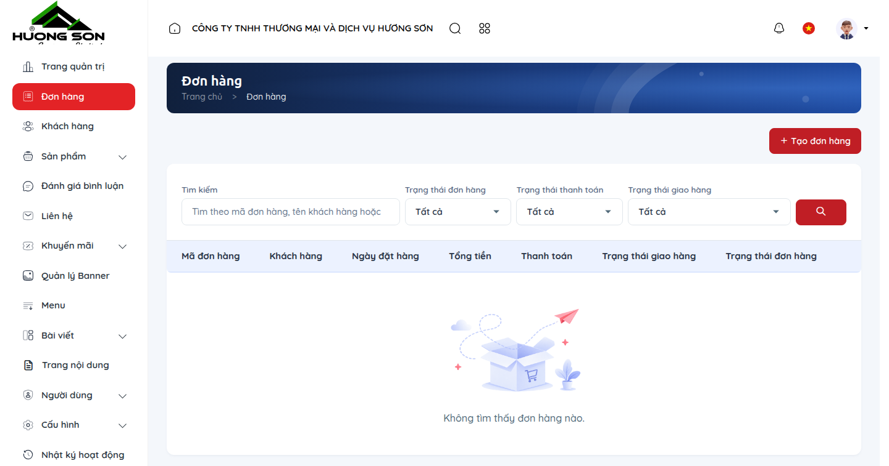

### 3. Bảng tra cứu hành động & Ký hiệu thao tác
| Ký hiệu | Khu vực / Tên trường | Hướng dẫn thao tác & Lưu ý nghiệp vụ |
| :---: | :--- | :--- |
| **①** | **Bộ lọc trạng thái đơn** | Lọc nhanh: Chờ xử lý, Đã xác nhận, Đang vận chuyển, Đã giao thành công, Đã hủy. |
| **②** | **Thông tin khách hàng & VAT** | Hiển thị đầy đủ Tên đơn vị, Mã số thuế, Địa chỉ giao hàng và Số điện thoại người nhận máy. |
| **③** | **Nút đẩy vận đơn tích hợp** | Tự động kết nối API lấy mã vận đơn và in tem nhãn giao nhận tiêu chuẩn. |
| **④** | **In phiếu bàn giao & Hóa đơn** | Xuất file in chuẩn A4 kèm đầy đủ điều khoản bảo hành thiết bị của Hương Sơn. |

### 4. Lưu ý nghiệp vụ quan trọng
- 💡 **Lưu ý nghiệp vụ:** Với các đơn hàng giá trị cao (máy photocopy trên 30 triệu hoặc máy in Duplo), bắt buộc nhân viên kinh doanh phải gọi điện xác nhận đặt cọc trước khi xuất kho.
- 💡 **Lưu ý nghiệp vụ:** Mọi đơn hàng đều lưu lại vết thời gian thay đổi trạng thái và tên nhân sự xử lý để phục vụ đối soát.

---

## CHƯƠNG 7: TIẾP NHẬN & XỬ LÝ YÊU CẦU BÁO GIÁ / THUÊ MÁY (RFQ & LEADS)

**Phân loại:** `BÁN HÀNG & THƯƠNG MẠI` | **Đặc tả nhãn:** `LEADS & RFQ`

**Mô tả tổng quan:** Quản lý các biểu mẫu yêu cầu tư vấn, yêu cầu báo giá dự án thầu, đăng ký thuê máy photocopy và yêu cầu chạy thử máy in siêu tốc Duplo từ các trường học, ngân hàng, sở ban ngành.

### 1. Quy trình thao tác chuẩn từng bước
- Truy cập menu 'Yêu cầu tư vấn' (`/vi/admin/contact-submissions`).
- Hệ thống hiển thị bảng danh sách các lead mới nhất: Họ tên người liên hệ, Đơn vị/Trường học, Số điện thoại, Email, Dịch vụ quan tâm (Thuê máy photo / Mua máy Duplo / Sửa chữa bảo trì), Nội dung ghi chú.
- Bấm vào dòng yêu cầu để xem chi tiết đầy đủ nội dung khách hàng gửi từ website.
- Sau khi chuyên viên kinh doanh/kỹ thuật đã gọi điện tư vấn và gửi file báo giá qua Zalo/Email, bấm công tắc 'Đã xử lý' để đánh dấu hoàn tất.
- Có thể phân loại lead vào nhóm khách hàng tiềm năng hoặc xuất danh sách ra file Excel phục vụ chăm sóc định kỳ.

### 2. Giao diện thực tế & Đường dẫn màn hình (Screenshots)
> 🌐 **Đường dẫn màn hình:** `https://huongsonco.com.vn/vi/admin/contact-submissions`
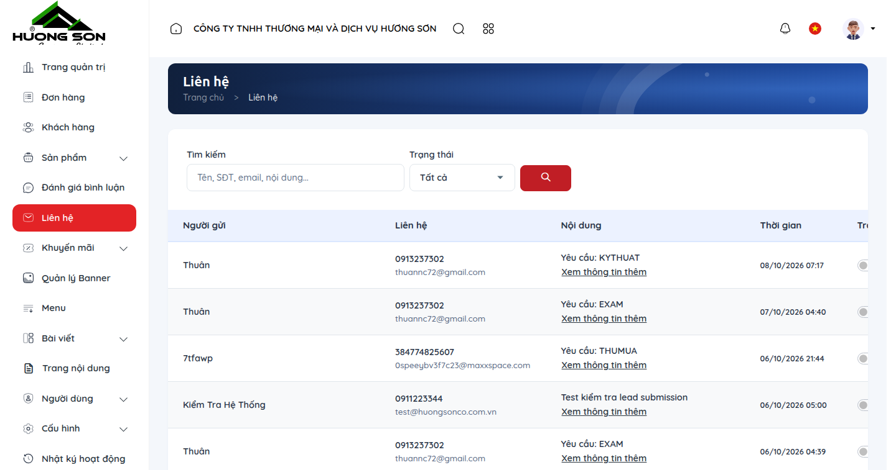

### 3. Bảng tra cứu hành động & Ký hiệu thao tác
| Ký hiệu | Khu vực / Tên trường | Hướng dẫn thao tác & Lưu ý nghiệp vụ |
| :---: | :--- | :--- |
| **①** | **Bảng danh sách Lead liên hệ** | Sắp xếp theo thứ tự mới nhất, hiển thị nhãn dịch vụ khách quan tâm. |
| **②** | **Nút đánh dấu Đã liên hệ / Chưa liên hệ** | Chuyển trạng thái trực quan để tránh trùng lặp giữa các nhân viên sale. |
| **③** | **Bộ lọc theo loại dịch vụ** | Lọc riêng: Yêu cầu thuê máy, Yêu cầu báo giá thiết bị mới, Yêu cầu sửa chữa dịch vụ. |
| **④** | **Hộp thoại ghi chú tư vấn** | Ghi lại tóm tắt nhu cầu khách hàng (số lượng bản in/tháng, ngân sách dự kiến, thời gian cần máy). |

### 4. Lưu ý nghiệp vụ quan trọng
- 💡 **Lưu ý nghiệp vụ:** Cam kết dịch vụ của Hương Sơn: Khách hàng gửi yêu cầu tư vấn trên website phải được chuyên viên liên hệ lại trong vòng 15 - 30 phút trong giờ hành chính.
- 💡 **Lưu ý nghiệp vụ:** Tích hợp thông báo tức thời qua Zalo OA quản trị giúp không bao giờ bị bỏ sót khách hàng tiềm năng.

---

## CHƯƠNG 8: CẨM NANG KỸ THUẬT, HƯỚNG DẪN SỬA LỖI & CHUẨN SEO (POSTS & SEO)

**Phân loại:** `NỘI DUNG & TRUYỀN THÔNG` | **Đặc tả nhãn:** `POSTS & SEO`

**Mô tả tổng quan:** Hệ thống quản lý bài viết Cẩm nang kỹ thuật máy văn phòng, hướng dẫn xử lý mã lỗi máy photocopy Toshiba/Konica, kỹ thuật in đề thi bằng máy Duplo, tối ưu hóa công cụ tìm kiếm chuẩn Google & AI Engine (AEO).

### 1. Quy trình thao tác chuẩn từng bước
- Truy cập menu 'Bài viết' > 'Tất cả bài viết' (`/vi/admin/posts`) hoặc 'Chuyên mục bài viết' (`/vi/admin/post-categories`).
- Bấm 'Thêm bài viết mới': Nhập Tiêu đề bài viết chuẩn SEO (VD: `Cách Khắc Phục Lỗi Kẹt Giấy Máy Photocopy Toshiba e-STUDIO Chi Tiết Từ A-Z`).
- Chọn Chuyên mục: 'Cẩm Nang Kỹ Thuật', 'Kinh Nghiệm Thuê Máy', 'Tin Tức Hoạt Động', hoặc 'Giải Pháp In Đề Thi Trường Học'.
- Soạn thảo nội dung: Sử dụng trình soạn thảo trực quan, chèn hình ảnh minh họa thực tế, bảng biểu thông số, video clip hướng dẫn thao tác thay mực/thay giấy.
- Thiết lập khối Meta SEO: Nhập Meta Title (tối ưu 55-60 ký tự), Meta Description (150-160 ký tự), Đường dẫn tĩnh (Slug chuẩn không dấu), Ảnh đại diện chia sẻ mạng xã hội (OG Image).
- Tích chọn 'Xuất bản' và bấm 'Lưu bài viết'.

### 2. Giao diện thực tế & Đường dẫn màn hình (Screenshots)
> 🌐 **Đường dẫn màn hình:** `https://huongsonco.com.vn/vi/admin/posts`
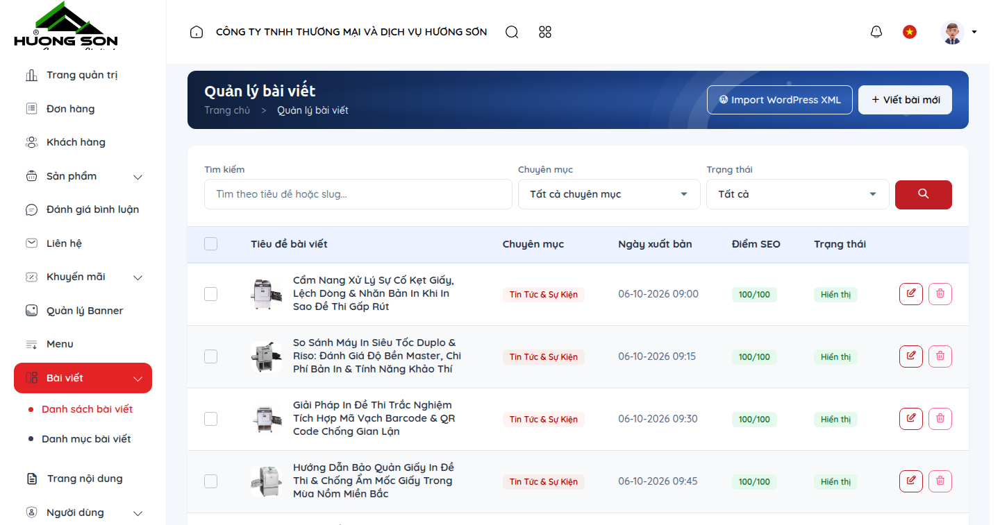

### 3. Bảng tra cứu hành động & Ký hiệu thao tác
| Ký hiệu | Khu vực / Tên trường | Hướng dẫn thao tác & Lưu ý nghiệp vụ |
| :---: | :--- | :--- |
| **①** | **Bảng quản lý bài viết** | Hiển thị tiêu đề, chuyên mục, tác giả, lượt xem, trạng thái xuất bản và ngày đăng bài. |
| **②** | **Trình soạn thảo trực quan Rich Text** | Hỗ trợ định dạng văn bản chuyên nghiệp, chèn bảng mã lỗi kỹ thuật, nhúng video YouTube. |
| **③** | **Bộ công cụ xem trước Google Search Snippet** | Mô phỏng chính xác giao diện hiển thị bài viết trên kết quả tìm kiếm Google di động & máy tính. |
| **④** | **Cấu hình Schema.org tự động** | Hệ thống tự động sinh cấu trúc dữ liệu NewsArticle / TechArticle / Breadcrumbs hỗ trợ Google Index nhanh. |

### 4. Lưu ý nghiệp vụ quan trọng
- 💡 **Lưu ý nghiệp vụ:** Các bài viết kỹ thuật thực tế (như bảng tra cứu mã lỗi SC của máy photocopy) mang lại lượng truy cập tự nhiên cực lớn từ các trường học và văn phòng doanh nghiệp.
- 💡 **Lưu ý nghiệp vụ:** Tuyệt đối không sao chép nội dung nguyên văn từ website khác để bảo vệ điểm uy tín SEO của domain huongsonco.com.vn.

---

## CHƯƠNG 9: MÃ GIẢM GIÁ & CHƯƠNG TRÌNH KHUYẾN MÃI (VOUCHERS & PROMOTIONS)

**Phân loại:** `BÁN HÀNG & THƯƠNG MẠI` | **Đặc tả nhãn:** `PROMOTIONS`

**Mô tả tổng quan:** Thiết lập các mã voucher chiết khấu khi mua mực in theo thùng, chương trình tặng kèm phụ kiện/miễn phí tháng đầu khi ký hợp đồng thuê máy photocopy dài hạn từ 12 tháng.

### 1. Quy trình thao tác chuẩn từng bước
- Truy cập menu 'Khuyến mãi' > 'Mã giảm giá' (`/vi/admin/vouchers`) hoặc 'Chương trình khuyến mãi' (`/vi/admin/promotions`).
- Tạo voucher mới: Nhập Mã code (VD: `THUEMAY2026`, `FANSIPAN10`).
- Chọn loại giảm giá: Giảm theo % giá trị đơn hàng hoặc Giảm một số tiền cố định (VD: Giảm 500.000đ cho đơn hàng thuê máy).
- Thiết lập điều kiện áp dụng: Giá trị đơn hàng tối thiểu, Số lượt sử dụng tối đa của mã, Số lượt sử dụng tối đa trên mỗi khách hàng.
- Chọn Thời gian hiệu lực: Từ ngày bắt đầu đến ngày kết thúc chiến dịch.
- Kích hoạt trạng thái 'Hoạt động' và lưu cấu hình.

### 2. Giao diện thực tế & Đường dẫn màn hình (Screenshots)
> 🌐 **Đường dẫn màn hình:** `https://huongsonco.com.vn/vi/admin/vouchers`
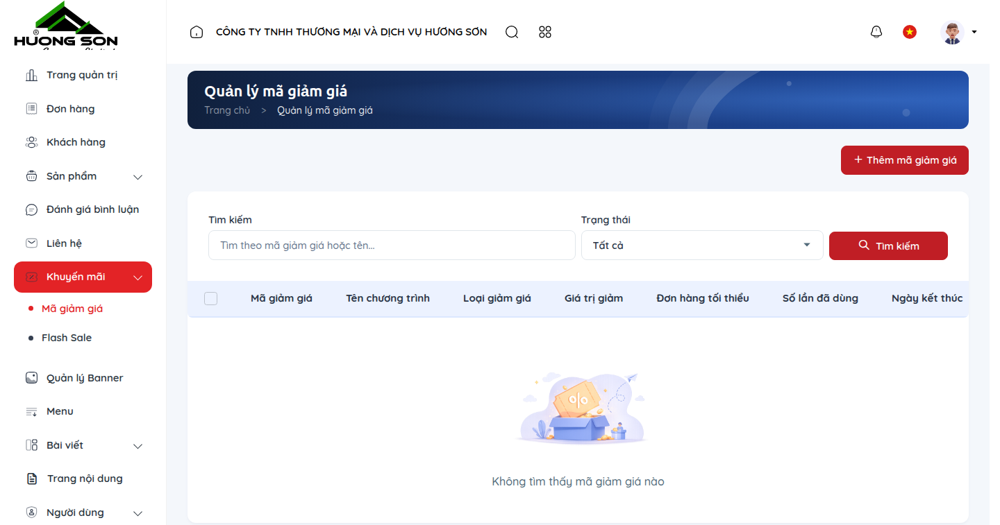

### 3. Bảng tra cứu hành động & Ký hiệu thao tác
| Ký hiệu | Khu vực / Tên trường | Hướng dẫn thao tác & Lưu ý nghiệp vụ |
| :---: | :--- | :--- |
| **①** | **Bảng danh sách Voucher** | Theo dõi mã code, mức giảm, số lượt đã sử dụng / tổng số lượt phát hành, thời hạn. |
| **②** | **Công tắc bật/tắt tức thời** | Tạm dừng chương trình khuyến mãi bất kỳ lúc nào khi hết ngân sách dự kiến. |
| **③** | **Giới hạn danh mục áp dụng** | Áp dụng voucher riêng cho danh mục 'Mực in Fansipan' hoặc dòng máy cụ thể. |
| **④** | **Thống kê hiệu quả chiến dịch** | Xem tổng số đơn hàng đã áp dụng voucher và tổng số tiền đã chiết khấu cho khách hàng. |

### 4. Lưu ý nghiệp vụ quan trọng
- 💡 **Lưu ý nghiệp vụ:** Nên đặt mã voucher dễ nhớ, ngắn gọn (VD: HUONGSON2026, DUPLO500) khi in trên tờ rơi hoặc gửi qua email marketing.
- 💡 **Lưu ý nghiệp vụ:** Hệ thống tự động kiểm tra tính hợp lệ của voucher tại bước thanh toán để ngăn chặn gian lận dùng nhiều lần.

---

## CHƯƠNG 10: KIỂM DUYỆT ĐÁNH GIÁ KHÁCH HÀNG (CUSTOMER REVIEWS MODERATION)

**Phân loại:** `NỘI DUNG & TRUYỀN THÔNG` | **Đặc tả nhãn:** `REVIEWS`

**Mô tả tổng quan:** Kiểm duyệt ý kiến phản hồi, đánh giá số sao (1-5 sao) và nhận xét của khách hàng doanh nghiệp, trường học về chất lượng máy in và dịch vụ kỹ thuật Hương Sơn trước khi hiển thị công khai trên website.

### 1. Quy trình thao tác chuẩn từng bước
- Truy cập menu 'Đánh giá' (`/vi/admin/reviews`).
- Xem danh sách phản hồi mới: Tên khách hàng, Đơn vị/Cơ quan, Sản phẩm/Dịch vụ được đánh giá, Số sao, Nội dung nhận xét, Ngày gửi.
- Kiểm tra tính xác thực: Đảm bảo nội dung đánh giá văn minh, mang tính đóng góp xây dựng.
- Duyệt hiển thị: Bật công tắc 'Hiển thị' để review xuất hiện trên trang chi tiết sản phẩm và trang chủ.
- Trường hợp phản ánh sự cố kỹ thuật: Chuyển thông tin ngay cho phòng kỹ thuật bảo trì liên hệ khắc phục, sau đó phản hồi lại khách hàng.

### 2. Giao diện thực tế & Đường dẫn màn hình (Screenshots)
> 🌐 **Đường dẫn màn hình:** `https://huongsonco.com.vn/vi/admin/reviews`
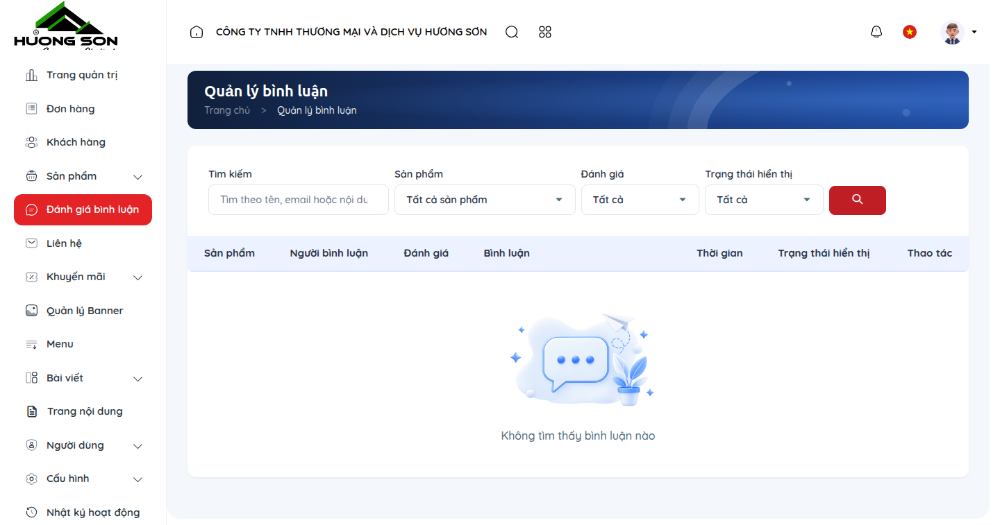

### 3. Bảng tra cứu hành động & Ký hiệu thao tác
| Ký hiệu | Khu vực / Tên trường | Hướng dẫn thao tác & Lưu ý nghiệp vụ |
| :---: | :--- | :--- |
| **①** | **Bảng kiểm duyệt phản hồi** | Phân loại đánh giá theo số sao (1-5 sao) và trạng thái hiển thị. |
| **②** | **Công tắc phê duyệt (Visibility)** | Chỉ những đánh giá được quản trị viên duyệt mới xuất hiện trên website storefront. |
| **③** | **Chỉnh sửa phản hồi** | Hỗ trợ chỉnh sửa lỗi chính tả trước khi đăng tải mà không làm thay đổi ý nghĩa của khách. |
| **④** | **Xóa phản hồi spam** | Loại bỏ các bình luận quảng cáo rác hoặc nội dung vi phạm tiêu chuẩn cộng đồng. |

### 4. Lưu ý nghiệp vụ quan trọng
- 💡 **Lưu ý nghiệp vụ:** Các đánh giá tích cực từ các khách hàng lớn (như các trường THPT, ngân hàng chi nhánh) là bằng chứng xã hội uy tín nhất giúp tăng tỷ lệ chốt hợp đồng thuê máy.
- 💡 **Lưu ý nghiệp vụ:** Nên duy trì điểm đánh giá trung bình từ 4.8 - 5.0 sao trên toàn bộ website.

---

## CHƯƠNG 11: QUẢN LÝ BANNER & CHIẾN DỊCH TRƯNG BÀY (BANNERS & HERO SLIDERS)

**Phân loại:** `GIAO DIỆN & TRẢI NGHIỆM` | **Đặc tả nhãn:** `BANNERS`

**Mô tả tổng quan:** Quản lý hệ thống banner slider trang chủ, banner giới thiệu chương trình 'Thuê máy Photocopy chỉ từ 800.000đ/tháng', banner độc quyền máy in nhân bản Duplo Nhật Bản và các đợt khuyến mãi mực in.

### 1. Quy trình thao tác chuẩn từng bước
- Truy cập menu 'Banner' (`/vi/admin/banners`).
- Bấm 'Thêm banner': Đặt Tiêu đề banner (VD: `Chiến Dịch Cho Thuê Máy Photocopy Toshiba Hà Nội 2026`).
- Tải lên ảnh banner phiên bản Desktop (kích thước tối ưu 1920x650px) và phiên bản Mobile (kích thước tối ưu 800x600px).
- Điền liên kết điều hướng khi khách bấm vào banner (VD: `/thue-may-photocopy-ha-noi` hoặc `/nhan-tu-van`).
- Nhập thứ tự sắp xếp hiển thị (Số nhỏ hiển thị trước) và tích chọn vị trí hiển thị (Slider trang chủ, Banner sidebar hoặc Banner chân trang).
- Bật trạng thái 'Hoạt động' và nhấn 'Lưu banner'.

### 2. Giao diện thực tế & Đường dẫn màn hình (Screenshots)
> 🌐 **Đường dẫn màn hình:** `https://huongsonco.com.vn/vi/admin/banners`
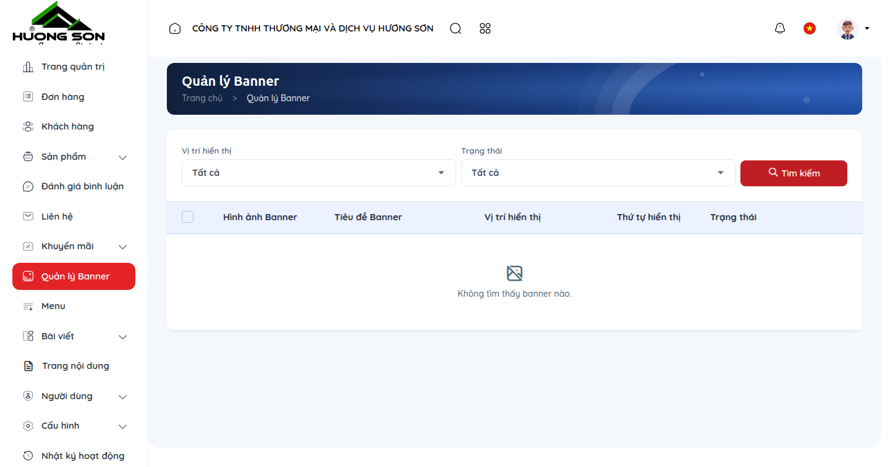

### 3. Bảng tra cứu hành động & Ký hiệu thao tác
| Ký hiệu | Khu vực / Tên trường | Hướng dẫn thao tác & Lưu ý nghiệp vụ |
| :---: | :--- | :--- |
| **①** | **Bảng danh sách banner chiến dịch** | Xem trước ảnh thumbnail banner, vị trí hiển thị, số lượt click và trạng thái. |
| **②** | **Kéo thả sắp xếp thứ tự** | Dễ dàng thay đổi thứ tự trượt của slider trang chủ mà không cần nhập số thủ công. |
| **③** | **Cấu hình ảnh kép Desktop / Mobile** | Đảm bảo hình ảnh banner luôn hiển thị sắc nét, không bị vỡ hoặc che khuất chữ trên điện thoại. |
| **④** | **Cài đặt thời gian tự động bật/tắt** | Thiết lập ngày bắt đầu và kết thúc chiến dịch quảng cáo theo từng quý. |

### 4. Lưu ý nghiệp vụ quan trọng
- 💡 **Lưu ý nghiệp vụ:** Dung lượng file ảnh banner nên nén dưới 250KB (định dạng WebP hoặc JPG chất lượng 85%) để đảm bảo tốc độ tải trang chủ dưới 1.5 giây.
- 💡 **Lưu ý nghiệp vụ:** Chữ trên banner nên ngắn gọn, tập trung vào ưu thế: Máy chính hãng, Lắp đặt trong 2h, Đổi máy mới nếu phát sinh lỗi.

---

## CHƯƠNG 12: QUẢN LÝ MENU ĐIỀU HƯỚNG WEBSITE (NAVIGATION MENUS)

**Phân loại:** `GIAO DIỆN & TRẢI NGHIỆM` | **Đặc tả nhãn:** `MENUS`

**Mô tả tổng quan:** Cấu trúc hệ thống menu chính (Header Navigation Mega Menu), menu chân trang (Footer Menu) và menu liên kết nhanh dịch vụ cho thuê máy của Hương Sơn.

### 1. Quy trình thao tác chuẩn từng bước
- Truy cập menu 'Menu' (`/vi/admin/menus`).
- Chọn menu cần cấu hình: Bấm 'Quản lý mục' (Items) của 'Menu chính' (Primary Menu) hoặc 'Menu chân trang' (Footer Menu).
- Thêm mục menu mới: Nhấn 'Thêm mục menu', nhập Tên hiển thị (Tiếng Việt & Tiếng Anh), chọn Loại liên kết (Trang sản phẩm, Danh mục, Bài viết cẩm nang hoặc Đường dẫn tùy chỉnh).
- Tạo menu đa cấp (Sub-menu): Kéo thả mục con sang phải để tạo cấp lùi vào (VD: Mục 'Máy Photocopy' chứa các mục con 'Photocopy Toshiba', 'Photocopy Konica Minolta', 'Photocopy Ricoh').
- Bấm 'Lưu sắp xếp' để cập nhật menu hiển thị ra ngoài website.

### 2. Giao diện thực tế & Đường dẫn màn hình (Screenshots)
> 🌐 **Đường dẫn màn hình:** `https://huongsonco.com.vn/vi/admin/menus`
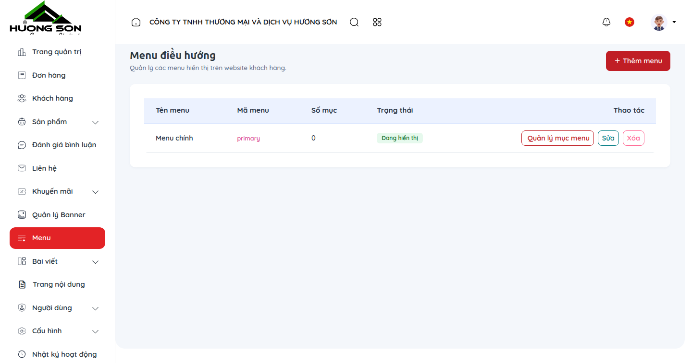

### 3. Bảng tra cứu hành động & Ký hiệu thao tác
| Ký hiệu | Khu vực / Tên trường | Hướng dẫn thao tác & Lưu ý nghiệp vụ |
| :---: | :--- | :--- |
| **①** | **Danh sách cây phân cấp menu** | Cấu trúc dạng cây trực quan, hiển thị rõ quan hệ menu cha - menu con. |
| **②** | **Kéo thả sắp xếp (Drag & Drop)** | Thao tác sắp xếp thứ tự và cấp độ lồng nhau cực kỳ mượt mà. |
| **③** | **Hỗ trợ đa ngôn ngữ nhãn menu** | Điền song ngữ Việt - Anh cho từng mục điều hướng. |
| **④** | **Tùy chọn mở tab mới (target=_blank)** | Dành cho các liên kết ra tài liệu ngoài hoặc trang web đối tác. |

### 4. Lưu ý nghiệp vụ quan trọng
- 💡 **Lưu ý nghiệp vụ:** Menu chính của Hương Sơn được thiết kế theo cấu trúc chuẩn SEO: Về Hương Sơn -> Sản Phẩm -> Dịch Vụ Cho Thuê -> Giải Pháp In Đề Thi -> Công Cụ -> Cẩm Nang -> Liên Hệ.
- 💡 **Lưu ý nghiệp vụ:** Không nên tạo quá 3 cấp menu con để tránh gây khó khăn cho người dùng thao tác trên màn hình cảm ứng di động.

---

## CHƯƠNG 13: THƯ VIỆN FILE, DRIVER & TÀI LIỆU PDF (MEDIA LIBRARY)

**Phân loại:** `NỘI DUNG & TRUYỀN THÔNG` | **Đặc tả nhãn:** `MEDIA`

**Mô tả tổng quan:** Quản lý tập trung toàn bộ kho hình ảnh máy photocopy, ảnh chụp thực tế tại kho, logo đối tác, file tài liệu hướng dẫn sử dụng (User Manual) và file cài đặt Driver máy in cung cấp cho khách hàng.

### 1. Quy trình thao tác chuẩn từng bước
- Truy cập menu 'Thư viện Media' (`/vi/admin/media`).
- Tải file lên: Nhấn 'Tải lên' hoặc kéo thả trực tiếp hình ảnh/file PDF từ máy tính vào cửa sổ thư viện.
- Tìm kiếm & lọc: Tìm kiếm theo tên file, lọc theo định dạng (Hình ảnh, Tài liệu PDF, Video).
- Lấy đường dẫn URL: Bấm vào file bất kỳ, nhấn 'Sao chép liên kết' để dán vào bài viết hoặc trang mô tả sản phẩm.
- Xóa file thừa: Chọn các file không còn sử dụng và bấm 'Xóa' để giải phóng dung lượng hosting.

### 2. Giao diện thực tế & Đường dẫn màn hình (Screenshots)
> 🌐 **Đường dẫn màn hình:** `https://huongsonco.com.vn/vi/admin/media`
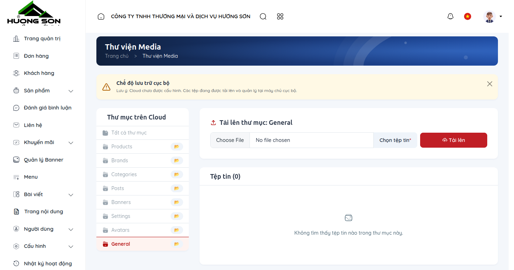

### 3. Bảng tra cứu hành động & Ký hiệu thao tác
| Ký hiệu | Khu vực / Tên trường | Hướng dẫn thao tác & Lưu ý nghiệp vụ |
| :---: | :--- | :--- |
| **①** | **Lưới hiển thị Media trực quan** | Xem trước hình ảnh dạng lưới thumbnail hoặc danh sách chi tiết kèm dung lượng file. |
| **②** | **Khu vực kéo thả Upload thông minh** | Hỗ trợ tải lên nhiều file cùng lúc, tự động tối ưu hóa và sinh thumbnail. |
| **③** | **Bộ chọn Media tích hợp (Media Picker)** | Gọi trực tiếp thư viện media từ màn hình soạn bài viết hoặc chỉnh sửa sản phẩm. |
| **④** | **Thông tin chi tiết file** | Xem kích thước pixel, dung lượng KB, định dạng MIME và đường dẫn URL tuyệt đối. |

### 4. Lưu ý nghiệp vụ quan trọng
- 💡 **Lưu ý nghiệp vụ:** Nên đặt tên file ảnh không dấu, cách nhau bằng dấu gạch ngang (VD: <code>may-photocopy-toshiba-3528a.jpg</code>) để tối ưu Google Image SEO.
- 💡 **Lưu ý nghiệp vụ:** Thư viện đã được cấu hình CDN và bộ nhớ đệm trình duyệt giúp tải ảnh siêu tốc.

---

## CHƯƠNG 14: QUẢN TRỊ KHỐI TĨNH & TRANG NỘI DUNG (SITE BLOCKS & CMS PAGES)

**Phân loại:** `GIAO DIỆN & TRẢI NGHIỆM` | **Đặc tả nhãn:** `SITE BLOCKS`

**Mô tả tổng quan:** Chỉnh sửa trực tiếp nội dung các khối thông tin cố định trên trang chủ và các trang giới thiệu: 30 năm kinh nghiệm thành lập từ 1993, 6 cam kết dịch vụ vàng của Hương Sơn, quy trình thuê máy 4 bước, chính sách bảo hành.

### 1. Quy trình thao tác chuẩn từng bước
- Truy cập menu 'Trang CMS' > 'Khối nội dung' (`/vi/admin/pages`).
- Chọn trang cần chỉnh sửa (VD: Trang chủ, Trang Về Hương Sơn, Trang Dịch vụ cho thuê máy).
- Chỉnh sửa các khối text tĩnh: Thay đổi số liệu thống kê (30+ năm kinh nghiệm, 5.000+ máy đang vận hành, 1.200+ trường học & cơ quan tin dùng).
- Cập nhật nội dung các thẻ 'Cam kết dịch vụ': Cam kết đổi máy trong 24h nếu sự cố không thể khắc phục, Cam kết 100% mực in và linh kiện chính hãng.
- Bấm 'Lưu thay đổi' và kiểm tra hiển thị ngay trên website mà không cần can thiệp code.

### 2. Giao diện thực tế & Đường dẫn màn hình (Screenshots)
> 🌐 **Đường dẫn màn hình:** `https://huongsonco.com.vn/vi/admin/pages`
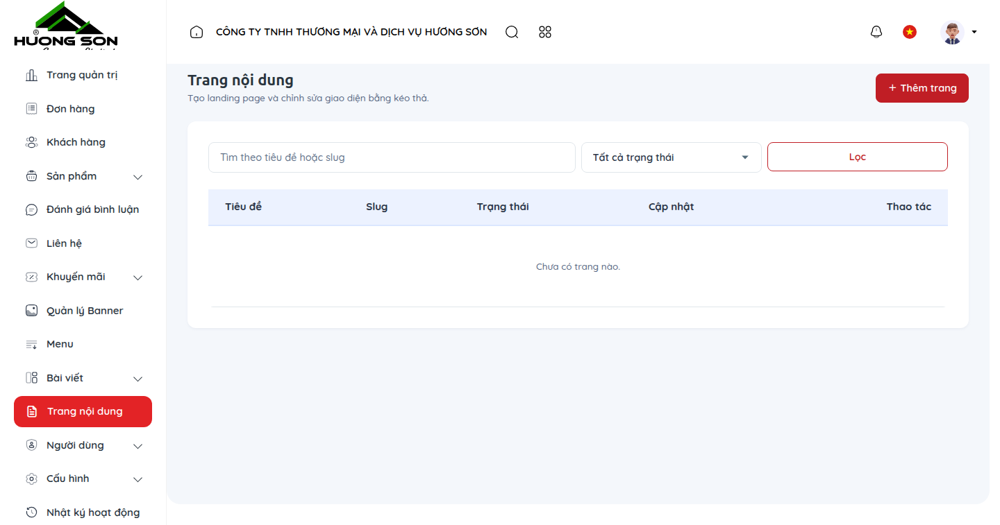

### 3. Bảng tra cứu hành động & Ký hiệu thao tác
| Ký hiệu | Khu vực / Tên trường | Hướng dẫn thao tác & Lưu ý nghiệp vụ |
| :---: | :--- | :--- |
| **①** | **Danh sách các trang tĩnh hệ thống** | Quản lý nội dung trang Giới thiệu, Chính sách bảo mật, Điều khoản dịch vụ, Bảng giá. |
| **②** | **Khối nội dung lặp lại (Site Lists)** | Thêm/sửa/xóa các mục danh sách cam kết, ưu đãi hoặc bước quy trình. |
| **③** | **Chỉnh sửa trực tiếp (Inline Editing)** | Giao diện trực quan cho phép chỉnh sửa từng đoạn text mà không sợ vỡ bố cục. |
| **④** | **Lịch sử phiên bản (Revisions)** | Hỗ trợ khôi phục lại nội dung phiên bản cũ nếu nhân viên lỡ chỉnh sửa sai. |

### 4. Lưu ý nghiệp vụ quan trọng
- 💡 **Lưu ý nghiệp vụ:** Các số liệu uy tín (năm thành lập 1993, số lượng khách hàng thân thiết) là điểm then chốt tạo niềm tin cho các đơn vị hành chính sự nghiệp khi đấu thầu.
- 💡 **Lưu ý nghiệp vụ:** Giữ nguyên các thẻ định dạng in đậm/nghiêng để bảo toàn tính thẩm mỹ của thiết kế giao diện.

---

## CHƯƠNG 15: CÀI ĐẶT HỆ THỐNG, CỔNG THANH TOÁN & VẬN CHUYỂN (SYSTEM SETTINGS)

**Phân loại:** `CẤU HÌNH & HỆ THỐNG` | **Đặc tả nhãn:** `SETTINGS`

**Mô tả tổng quan:** Cấu hình thông tin pháp nhân Công ty TNHH TM&DV Hương Sơn, địa chỉ trụ sở & showroom, hotline hỗ trợ kỹ thuật, cấu hình Zalo OA nhận thông báo lead, thiết lập đối tác vận chuyển và tài khoản thanh toán.

### 1. Quy trình thao tác chuẩn từng bước
- Truy cập menu 'Cài đặt' > 'Cài đặt chung' (`/vi/admin/settings`): Cập nhật Tên doanh nghiệp, Mã số thuế, Hotline kỹ thuật (0903.229.828 - 0968.229.828), Email tiếp nhận thông tin (`info@huongsonco.com.vn`).
- Cài đặt Thông báo (`/vi/admin/notification-settings`): Cấu hình Zalo Chat ID để hệ thống tự động bắn tin nhắn về điện thoại của quản lý khi có đơn hàng hoặc yêu cầu thuê máy mới.
- Đối tác vận chuyển (`/vi/admin/shipping-partners`): Bật/tắt các hình thức vận chuyển: Viettel Post, GHTK và Tự giao hàng bởi đội xe Hương Sơn.
- Phương thức thanh toán (`/vi/admin/payment-methods`): Cấu hình thanh toán khi nhận hàng (COD), Chuyển khoản ngân hàng Vietcombank (quét mã QR VietQR tự động điền nội dung) hoặc thanh toán online.
- Nhấn 'Lưu cấu hình' để áp dụng toàn hệ thống.

### 2. Giao diện thực tế & Đường dẫn màn hình (Screenshots)
> 🌐 **Đường dẫn màn hình:** `https://huongsonco.com.vn/vi/admin/settings`
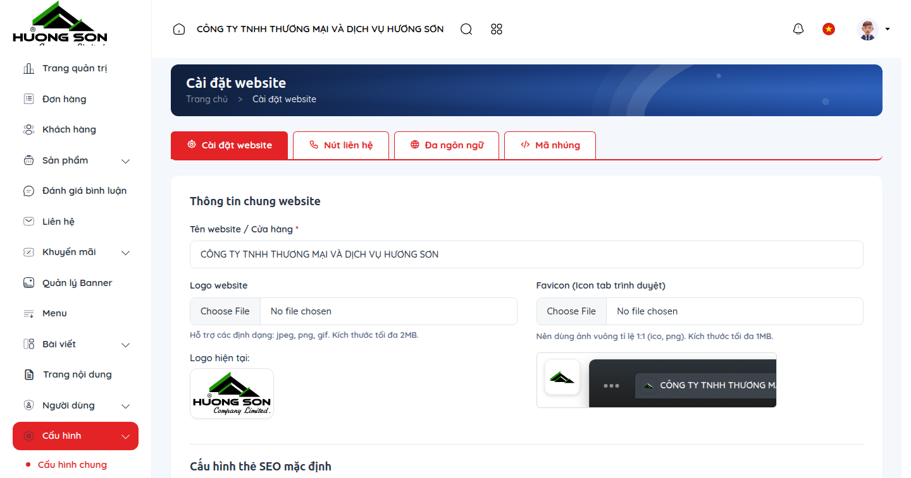

### 3. Bảng tra cứu hành động & Ký hiệu thao tác
| Ký hiệu | Khu vực / Tên trường | Hướng dẫn thao tác & Lưu ý nghiệp vụ |
| :---: | :--- | :--- |
| **①** | **Cấu hình thông tin doanh nghiệp** | Thông tin hiển thị tại chân trang website và trên các hóa đơn/biên bản bàn giao thiết bị. |
| **②** | **Tích hợp Zalo OA Webhook** | Cảnh báo đơn hàng & yêu cầu báo giá khẩn cấp tới nhóm kinh doanh theo thời gian thực. |
| **③** | **Quản lý đối tác vận chuyển** | Cài đặt phí vận chuyển theo khu vực nội thành Hà Nội hoặc gửi xe khách/bưu cục các tỉnh. |
| **④** | **Cấu hình tài khoản Vietcombank** | Tự động sinh mã VietQR chuẩn NAPAS giúp khách hàng thanh toán chính xác 100%. |

### 4. Lưu ý nghiệp vụ quan trọng
- 💡 **Lưu ý nghiệp vụ:** Hotline và địa chỉ văn phòng phải luôn được cập nhật chính xác để khách hàng có thể liên hệ hỗ trợ kỹ thuật 24/7.
- 💡 **Lưu ý nghiệp vụ:** Tuyệt đối bảo mật các khóa API tích hợp Zalo và cổng thanh toán.

---

## CHƯƠNG 16: QUẢN LÝ ĐA NGÔN NGỮ SONG NGỮ (LOCALIZATION & LANGUAGES)

**Phân loại:** `CẤU HÌNH & HỆ THỐNG` | **Đặc tả nhãn:** `LANGUAGES`

**Mô tả tổng quan:** Quản lý cơ chế song ngữ Tiếng Việt (`vi`) và Tiếng Anh (`en`) phục vụ các doanh nghiệp có vốn đầu tư nước ngoài (FDI), các văn phòng đại diện quốc tế có nhu cầu thuê máy photocopy tại Việt Nam.

### 1. Quy trình thao tác chuẩn từng bước
- Truy cập menu 'Ngôn ngữ' (`/vi/admin/languages`).
- Xem danh sách ngôn ngữ đang kích hoạt: Tiếng Việt (mặc định) và Tiếng Anh.
- Bật/tắt ngôn ngữ: Khi chưa hoàn thiện bản dịch tiếng Anh cho sản phẩm mới, có thể tạm ẩn ngôn ngữ đó.
- Dịch giao diện & sản phẩm: Trong từng màn hình quản lý sản phẩm hoặc bài viết, hệ thống cung cấp các tab nhập liệu riêng biệt cho bản tiếng Việt và tiếng Anh.
- Kiểm tra chuyển đổi ngôn ngữ trên Header storefront qua công tắc cờ ngôn ngữ.

### 2. Giao diện thực tế & Đường dẫn màn hình (Screenshots)
> 🌐 **Đường dẫn màn hình:** `https://huongsonco.com.vn/vi/admin/languages`
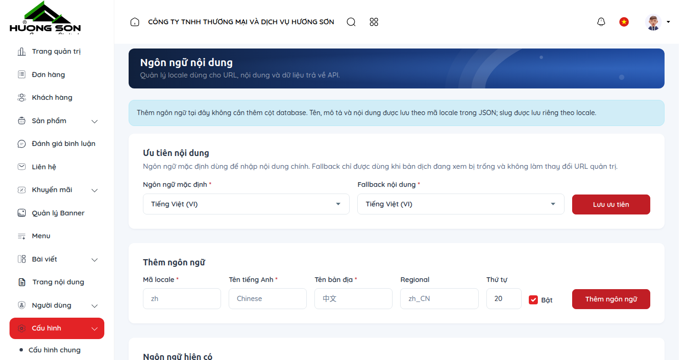

### 3. Bảng tra cứu hành động & Ký hiệu thao tác
| Ký hiệu | Khu vực / Tên trường | Hướng dẫn thao tác & Lưu ý nghiệp vụ |
| :---: | :--- | :--- |
| **①** | **Bảng quản lý ngôn ngữ** | Hiển thị mã ngôn ngữ (vi/en), cờ quốc gia, trạng thái hoạt động và cờ mặc định. |
| **②** | **Công tắc chuyển đổi Locale** | Cho phép chuyển đổi giao diện quản trị viên sang tiếng Anh nếu có nhân sự nước ngoài. |
| **③** | **Bản dịch giao diện động** | Hỗ trợ dịch nhanh các nhãn nút bấm, thông báo hệ thống và placeholder biểu mẫu. |
| **④** | **Fallback ngôn ngữ thông minh** | Tự động hiển thị nội dung tiếng Việt nếu bản dịch tiếng Anh của sản phẩm chưa có. |

### 4. Lưu ý nghiệp vụ quan trọng
- 💡 **Lưu ý nghiệp vụ:** Nhiều khách hàng khu công nghiệp (KCN Thăng Long, KCN Quang Minh...) là các công ty Nhật Bản, Hàn Quốc, việc hoàn thiện giao diện tiếng Anh giúp gia tăng cơ hội ký hợp đồng thuê máy dài hạn.
- 💡 **Lưu ý nghiệp vụ:** Đảm bảo URL chuẩn SEO: <code>/vi/...</code> cho tiếng Việt và <code>/en/...</code> cho tiếng Anh.

---

## CHƯƠNG 17: NHẬT KÝ KIỂM TOÁN & TRUY VẾT BẢO MẬT (ACTIVITY AUDIT LOGS)

**Phân loại:** `CẤU HÌNH & HỆ THỐNG` | **Đặc tả nhãn:** `AUDIT LOGS`

**Mô tả tổng quan:** Ghi nhận chi tiết mọi hành vi thao tác của các thành viên trong ban quản trị: Ai đã cập nhật giá thuê máy, ai đã duyệt đơn hàng, ai đã xóa dữ liệu, kèm địa chỉ IP và dấu vết thời gian chính xác.

### 1. Quy trình thao tác chuẩn từng bước
- Truy cập menu 'Nhật ký hoạt động' (`/vi/admin/activity-logs`).
- Bảng hiển thị các cột thông tin: Thời gian thực hiện, Tài khoản nhân viên, Hành động (Tạo mới, Cập nhật, Xóa, Đăng nhập), Tên module bị tác động (Sản phẩm, Đơn hàng, Vai trò), Địa chỉ IP mạng.
- Bấm vào biểu tượng 'Xem chi tiết' để xem dữ liệu trước và sau khi thay đổi (Dữ liệu cũ vs Dữ liệu mới).
- Sử dụng bộ lọc tìm kiếm theo nhân sự hoặc theo khoảng thời gian để phục vụ công tác thanh tra nội bộ khi có sự cố dữ liệu.

### 2. Giao diện thực tế & Đường dẫn màn hình (Screenshots)
> 🌐 **Đường dẫn màn hình:** `https://huongsonco.com.vn/vi/admin/activity-logs`
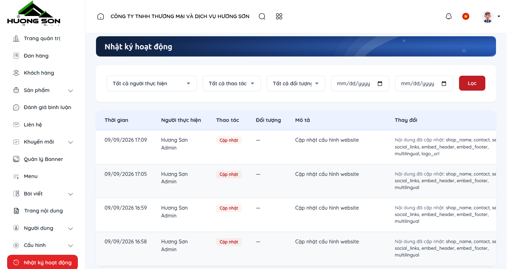

### 3. Bảng tra cứu hành động & Ký hiệu thao tác
| Ký hiệu | Khu vực / Tên trường | Hướng dẫn thao tác & Lưu ý nghiệp vụ |
| :---: | :--- | :--- |
| **①** | **Bảng nhật ký kiểm toán bất biến** | Dữ liệu nhật ký được bảo vệ chỉ đọc (Read-only), không ai kể cả admin có thể sửa đổi hay xóa. |
| **②** | **So sánh chênh lệch dữ liệu (Diff Viewer)** | Hiển thị trực quan trường dữ liệu nào bị thay đổi giá trị và giá trị cũ là gì. |
| **③** | **Ghi nhận thông tin bảo mật IP & User Agent** | Hỗ trợ phát hiện truy cập bất thường từ các dải IP lạ. |
| **④** | **Xuất file báo cáo kiểm toán** | Hỗ trợ xuất nhật ký ra Excel phục vụ báo cáo định kỳ cho Ban Giám Đốc. |

### 4. Lưu ý nghiệp vụ quan trọng
- 💡 **Lưu ý nghiệp vụ:** Nhật ký hoạt động là công cụ đắc lực giúp giải quyết các hiểu lầm giữa bộ phận kinh doanh và kho khi xảy ra sai lệch thông tin đơn hàng.
- 💡 **Lưu ý nghiệp vụ:** Hệ thống tự động lưu trữ nhật ký tối thiểu 180 ngày phục vụ công tác an ninh mạng.

---

## CHƯƠNG 18: CÔNG CỤ ƯỚC TÍNH CHI PHÍ THUÊ MÁY PHOTOCOPY & TCO (STOREFRONT TOOLS)

**Phân loại:** `CÔNG CỤ TÍNH TOÁN ĐẶC THÙ` | **Đặc tả nhãn:** `CALCULATOR & TCO`

**Mô tả tổng quan:** Cẩm nang hướng dẫn sử dụng và kiểm tra công cụ tính toán chi phí thuê máy photocopy trực tuyến và công cụ so sánh tổng chi phí sở hữu TCO (Total Cost of Ownership) độc quyền của Hương Sơn trên website storefront.

### 1. Quy trình thao tác chuẩn từng bước
- Truy cập công cụ trên website storefront tại đường dẫn: `https://huongsonco.com.vn/cong-cu/tinh-chi-phi-thue-may` (hoặc `https://huongsonco.com.vn/cong-cu/tinh-tco`).
- Bước 1: Chọn Khổ giấy in chủ yếu (Khổ A4 tiêu chuẩn hoặc Khổ A3 / A4 hỗn hợp).
- Bước 2: Chọn Loại bản in: Chỉ in đen trắng (Monochrome) hoặc Có in màu (Color).
- Bước 3: Kéo thanh trượt hoặc nhập Sản lượng in dự kiến mỗi tháng (VD: 3.000 bản, 5.000 bản hoặc 15.000 bản/tháng).
- Bước 4: Chọn Thời hạn dự kiến thuê máy (6 tháng, 12 tháng, 24 tháng hoặc 36 tháng).
- Quan sát kết quả tức thời: Hệ thống tính toán chính xác Giá thuê trọn gói hàng tháng (đã bao gồm định mức bản in miễn phí), Chi phí phụ trội trên mỗi bản in vượt mức, và Đề xuất dòng máy photocopy Toshiba/Konica tối ưu nhất.
- Khách hàng bấm 'Đăng ký thuê gói này ngay' để gửi thẳng dữ liệu cấu hình về hệ thống quản trị Hương Sơn.

### 2. Giao diện thực tế & Đường dẫn màn hình (Screenshots)
> 🌐 **Đường dẫn màn hình:** `https://huongsonco.com.vn/cong-cu/tinh-chi-phi-thue-may`
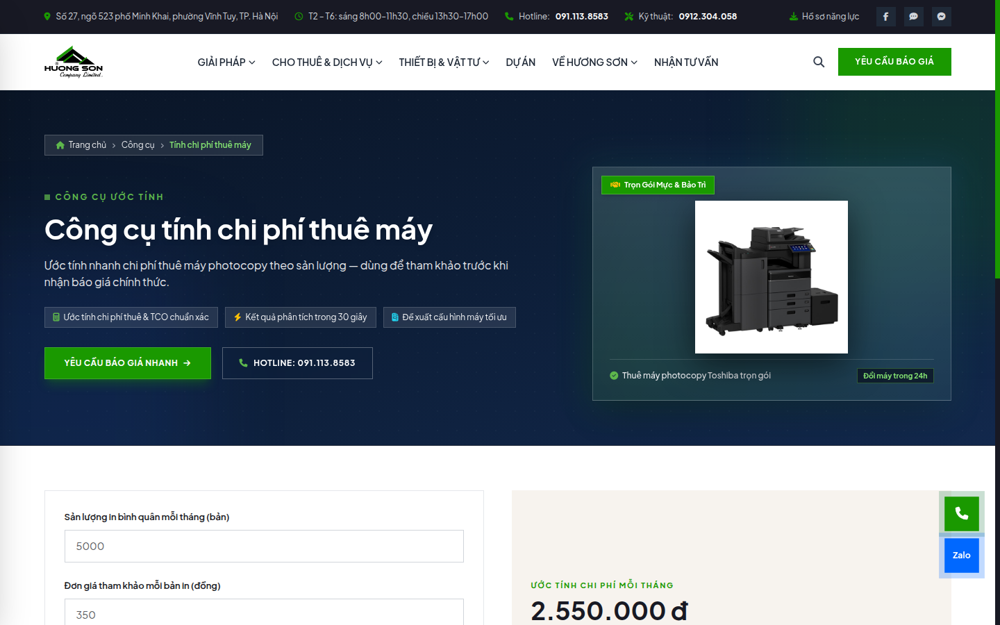

### 3. Bảng tra cứu hành động & Ký hiệu thao tác
| Ký hiệu | Khu vực / Tên trường | Hướng dẫn thao tác & Lưu ý nghiệp vụ |
| :---: | :--- | :--- |
| **①** | **Bộ chọn cấu hình in ấn** | Giao diện trực quan gồm các icon khổ giấy A4/A3 và tùy chọn in đen trắng/màu sinh động. |
| **②** | **Thanh trượt sản lượng bản in thông minh** | Người dùng dễ dàng kéo thả để điều chỉnh số lượng bản in từ 1.000 đến 30.000 bản/tháng. |
| **③** | **Thẻ kết quả báo giá dự toán** | Tính toán chi phí thuê tháng, chi phí bản chụp phụ trội và số tiền tiết kiệm được so với mua máy mới. |
| **④** | **Gợi ý model máy phù hợp** | Tự động hiển thị model máy tối ưu kèm hình ảnh và thông số kỹ thuật (VD: Toshiba 3028A cho văn phòng 5.000 bản/tháng). |

### 4. Lưu ý nghiệp vụ quan trọng
- 💡 **Lưu ý nghiệp vụ:** Công cụ ước tính chi phí thuê máy là 'vũ khí' chốt sale tự động mạnh mẽ nhất trên website Hương Sơn, giúp khách hàng tự tin đưa ra quyết định mà không cần chờ báo giá thủ công.
- 💡 **Lưu ý nghiệp vụ:** Tất cả các thông số định mức (giá gói gốc, định mức bản miễn phí, giá bản phụ trội 100đ - 150đ) được đồng bộ trực tiếp từ bảng giá dịch vụ cho thuê của công ty.

---
